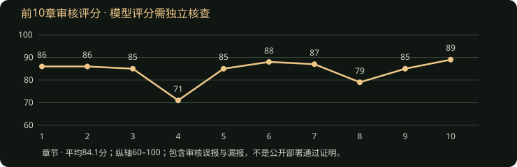

# Phase 4A — 10章检查点

2026-10-23完成。专用小说 `Long Novel Stress Test · 二十四小时之外`，ID `1ab255ea-a6db-4a86-a5a4-6fedea5fbb55`。主测试全部使用真实DeepSeek、Supabase和产品Generation Run服务；网页回归另行区分真实云端读取与本地模型夹具。

**10章全链路完成；可以继续受控压力测试，不代表可以公开部署。25/50/100章尚未完成。**

## 完整性与规模

| 指标 | 结果 |
| --- | ---: |
| 已写正文／摘要／成功记忆分析／最新有效审核 | 10／10／10／10 |
| AI正文历史版本 | 10，每章1个 |
| 去空白字符数（产品字数） | 50,850 |
| 纯汉字数 | 43,035 |
| 单章2500–3500目标达标 | 0/10 |
| Memory总数／active／resolved／obsolete | 133／125／8／0 |
| 未解决伏笔记录 | 15 |
| 人物（初始7名）／时间线事件 | 15／41 |
| 审核均分／Critical／High／Medium／Low／Info | 84.1／0／2／7／15／3 |

“0 Critical”仅表示模型未给此标签，不表示独立检查无重大风险。不得以数据库主键无重复等同语义记忆无重复。

## 请求、失败与耗时

45条生成日志中，42条返回实际Token用量；1次上游请求失败、用量未知；2次审核在调用前因上下文过大拒绝。因此实际发起43次DeepSeek请求尝试，不能把45条日志全部算成模型调用。日志失败15次，包括正文2、记忆3、审核10；总流程尝试失败率15/45=33.3%，包含修复前记录和调用前拒绝，不能外推为最终版本的稳定失败率。

累计已报告输入1,286,051 Token、输出353,817 Token，共1,639,868 Token。缺失的1次用量不按零成本计算，没有硬编码人民币价格。

| 步骤 | 日志尝试／失败 | 输入Token | 输出Token | 已记录耗时平均／P50／P95／最大（秒） |
| --- | --- | ---: | ---: | --- |
| 正文 | 12／2 | 238,745 | 81,897 | 55.09／49.99／89.07／89.07，11条有耗时 |
| 记忆 | 13／3 | 386,948 | 78,745 | 35.62／25.29／86.89／86.89 |
| 审核 | 20／10 | 660,358 | 193,175 | 53.24／53.45／88.05／97.69 |

第9章另有一次长时间中断：上游请求观测经过2,950,824ms，随后保存失败状态的数据库请求经过13,115,657ms后返回401；整个生成步骤16,071,611ms。后续会话恢复、读取成功，明确重试后第9章完成。无法从这些记录单独区分机器暂停、网络中断和服务端等待；不能把这4.46小时当正常模型生成时间，也不能从恢复测试中隐去。上表为数据库中已记录的调用耗时，包含失败尝试，不包含该条缺失耗时。原始步骤分布另保留，生成步骤平均1396.70秒、P95 16071.61秒。

## 字数、记忆与输入趋势

| 章 | 字数 | 审核分 | 正文输入Token | Memory总数／active |
| --- | ---: | ---: | ---: | --- |
| 1 | 3645 | 86 | 2798 | 15／15 |
| 2 | 4372 | 86 | 9821 | 30／29 |
| 3 | 4668 | 85 | 15266 | 44／43 |
| 4 | 5686 | 71 | 21317 | 57／54 |
| 5 | 5595 | 85 | 27213 | 74／69 |
| 6 | 4341 | 88 | 25152 | 87／82 |
| 7 | 6455 | 87 | 25693 | 99／93 |
| 8 | 6583 | 79 | 28196 | 108／101 |
| 9 | 5194 | 85 | 28131 | 121／114 |
| 10 | 4311 | 89 | 27579 | 133／125 |

正文输入在第5章后暂约25–28K，尚无50章证据。每章平均新增13.3条Memory，仍有明显增长；现有记忆分析300条保护未触发，不可仅靠外推宣称通过。全部章节超长，连续模式会保存带长度警告的正文，长度控制未通过。

## 独立检查与审核准确性

开发代理独立完整阅读第1、5、10章，并核对其他章节报告与原文证据。不是人类读者研究。

- Golden Fact GF10失败：初始存款18000、欠租6000，第4章预计次日付租后不足4000，第5章实际付5000后余3920.4，前期9079.6元支出来源未交代；第10章接续3920.4+3000−1000=5920.4虽局部相符，不能修复初始资金缺口。属于1类明确违规。第4章为未来计划，不计作第二次付租。
- 第10章算术错误：11张×每张0.02元=0.22元，正文写成2.22元；29笔每笔最多0.36元，合计最多10.44元，正文写19.84元。后一问题审核遗漏。
- 第10章审核还出现误报：原文184321.96−184321.74=0.22本来正确，审核描述将“.96”误读成“.36”后判错。返回的证据片段本身正确，说明严格引文校验不能保证推理正确。
- 审核以本章自动写入的Memory为“既定数值”，降低错误严重度；这是自我验证风险。本章Memory更新先于审核，污染防护不足。
- 第4章已回收卡号与未回收卡号混淆，老顾调岗时间前后不同；第8章“温永强／吴永强”次要人物姓名不一致。其他主要人物保留既定角色与地点，未把正常合作进展判为人物漂移。
- 能力界限在抽读章中没有实质展示；审核“未使用因此未违反”不能证明能力长期一致性。GF03/04/05及知情边界GF07/12仍需后续实际剧情验证。其余Golden Facts在抽读范围未见确证违规，暂为WARNING（覆盖不足），不出具50章PASS。
- 对白较自然、流程动作具体，但通勤、备案、计划和工作消息密度高，章纲关键事件被推迟。10章中7章开头出现早晨模式，7章开头出现手机相关词；这是字面统计，不能直接等于7次语义重复。独立阅读发现1/5/10章均较依赖次日待办和工作通知收尾。

## 伏笔与记忆质量

S1缺角运单第5章未按计划回收；S2门禁卡第8章未完成授权借卡的计划回收；S3两分钱第8章过早弱化、第10章重新收束，但计算证据存在错误。M1三号底稿、M2保险回执、M3辞职信、L1红桥仓单已经出现；L2九盏灯计划第12章，尚未到达。长期伏笔均未到回收窗口，不能称成功回收。

第4章快照57条中固定随机抽样50条：有价值27（54%）、重复15（30%）、过期4（8%）、过度细节2（4%）、无法验证1（2%）、错误1（2%）。重复含行内和跨行同义；第10章自动字面近似检测10对候选，不能代替上述语义分类。审阅ID和理由单独保存，不被后续统计覆盖。

## 修复与下一阶段决定

10章云端浏览器读取实测：Dashboard两次5.90/5.37秒、约18.9KB；Memory16.80/13.32秒、约662–694KB；Timeline11.13/9.64秒、约662–669KB；章节页28.93/19.10秒、约1.97–2.01MB。章节页每次打开触发三次完整小说请求，来自详情加载、历史记忆成功与历史Run完成各一次。随后改为比较服务器小说revision，仅新数据触发刷新并合并同账号同作品并发读；本地浏览器8组验收通过，重新打开已完成章节只请求一次详情。云端后测单独记录，不能回填10章基线。时间包含开发服务器和网络，字节为页面资源合计。

已修复：审核证据编号和类型引用、输出不完整识别、有界503重试、输入审计历史重复、审核目录编码开销、Dashboard全量读取、生产健康页访问保护。第10章后另修正历史摘要里反复携带的旧“下一章”要求：只保留紧邻上一章的要求，历史事实与数据库原件仍在；9组正文回归通过。下一阶段评估其效果，不能把修复后的效果回填到前10章成绩。

截至本检查点：安全补丁Next.js 16.4.2生产构建通过，生产依赖npm audit零报告，开发依赖仍有braces链的5项high记录；浏览器7组流程通过，生产健康页404验证通过，密钥扫描通过。最新诊断与历史计划改动须在阶段结束时再做最终构建复核。

批准在真实云端页面复核完成后继续到25章，仅用于暴露长期容量和质量问题。当前无尚未恢复的任务、重复正文或跨账号写入；但**NOT READY FOR PHASE 4B**：长度失控、记忆重复/过期、经济与算术事实污染、审核误报/漏报必须在公开部署前解决。不批准100章，不部署，不删除测试数据。

证据目录：`artifacts/phase4a/stress-2026-10-21T07-27-33-712Z/`，核心文件为`progress.json`、`snapshot-checkpoint-10.json`、`health.json`、`provider-calls.jsonl`、`model-inputs.jsonl`、`memory-audit-ch4.json`和`independent-inspection.json`。目录被Git忽略，不包含API key或测试账号密码。
