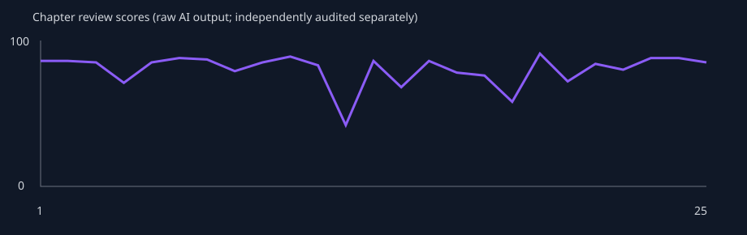

# Phase 4A — 25章检查点

快照时间：2026-10-27T03:18:55.214Z。真实DeepSeek、Supabase及产品服务；不是Fixture正文。**25章全链路完成；NOT READY FOR PHASE 4B。** 此文件记录测试成绩，不自动批准下一阶段。

本地私有证据：`artifacts/phase4a/stress-2026-10-21T07-27-33-712Z`。报告不包含账号或密钥，测试数据保留。

## 完整性与规模

| 指标 | 结果 |
| --- | --- |
| 正文 / 摘要 / 有效审核 | 25 / 25 / 25 |
| AI正文版本 | 25，每章1个 |
| 去空白字符数 / 纯汉字 | 136,912 / 115,220 |
| 2500–3500字达标章节 | 0/25 |
| Memory / active / resolved / obsolete | 295 / 287 / 8 / 0 |
| 人物 / 时间线 / 未解伏笔 | 19 / 98 / 38 |
| 审核均分 / Critical章节 | 80.24 / 3 |
| 显式步骤重试 / 独立检查后Critical继续 | 27 / 3 |

## 调用、Token及耗时

已返回用量的实际请求113次，遥测另记录1次无正常响应的请求；合计至少114次。生成日志119条还包含调用前拒绝，不能当作API调用数。累计已知输入4,373,738、输出965,120 Token；缺失用量不是零费用。没有硬编码人民币价格。

| 步骤 | 尝试 | 失败 | 输入Token | 输出Token | 平均 / P50 / P95 / 最大秒 |
| --- | --- | --- | --- | --- | --- |
| 正文 | 31 | 6 | 861,258 | 260,906 | 66.81 / 66.81 / 106.03 / 106.25 |
| Memory | 32 | 7 | 1,192,987 | 138,181 | 26.87 / 21.91 / 84.92 / 86.89 |
| 审核 | 56 | 31 | 2,319,493 | 566,033 | 58.16 / 64.57 / 93.84 / 97.69 |

已记录完整章节活跃步骤耗时：917.14 / 232.45 / 933.14 / 16241.02秒（平均/P50/P95/最大；不含人工检查、限额等待，早期遥测不全）。第9章存在主机/网络长中断，原始最大值保留，不当作正常模型推理耗时。

## 增长与质量趋势

| 章 | Memory | active | resolved | Writer输入Token | 提取候选数 | 提取请求字节 |
| --- | --- | --- | --- | --- | --- | --- |
| 1 | 15 | 15 | 0 | 2798 | 未记录 | 未记录 |
| 10 | 133 | 125 | 8 | 27579 | 未记录 | 122795 |
| 25 | 295 | 287 | 8 | 38926 | 116 | 127893 |

提取原始服务器合并索引不等于发送模型的上下文；候选最多120条/60KB，完整请求180KB限制不变。阶段区间内曾修复代码，不能把累计失败率外推为最终版本失败率。

| 章节区间 | 已写 | 均分 | Critical | High | Medium | 失败/尝试 | 原始水文风险均分 |
| --- | --- | --- | --- | --- | --- | --- | --- |
| 1–10 | 10 | 84.10 | 0 | 2 | 7 | 15/45 | 18.60 |
| 11–25 | 15 | 77.67 | 4 | 7 | 12 | 29/74 | 27.73 |

第13/14章水文风险分与文字评价方向相反；原始数字保留，不把量纲混乱解释为质量突然恶化。v5起区分质量和风险评分，v6在推理耗尽时采用一次无额外推理重试；报告返回成功不证明漏判已经消失。

## 独立抽检与记忆质量

抽检者为开发代理独立阅读原文，不是人类读者研究。要求抽检章节：1、5、10、20；尚缺：无。

### 第1章

- readability：场景、工作动作和对白具体，可读；早餐通勤篇幅偏多，商业核对有细节。
- character：谨慎核对而非轻信，苏宁维护原件权限，符合初始人设。
- plot：差异清单和缺角运单推进了任务，但没有执行章纲的能力边界验证；正文明确一次预见都未使用。
- style：结尾多次用明日计划和欠租提醒收束，略有总结重复；没有连续神秘来电或万能反转。
- dialogue：工作对话自然、具有权限边界，少量流程解释偏密。
- foreshadowing：蓝色缺角运单自然出现，尚未回收；另生成随印包装线索，后续需观察是否分散主线。
- reviewAccuracy：86分审核指出能力验证未落地，判断成立。原件保存主动性问题属于低等级执行偏差，未误判成Critical。
- goldenFacts：未发现明确违规，但24小时/十秒上限未在实际事件中展示，不能据此宣称已证明全部事实长期有效。
- memoryQuality：15条中有同义重复候选：四张缺角运单与连续号段；随印包装查询结果分别为secret和foreshadowing；待50条固定抽样量化。

### 第5章

- readability：运输员证言及导师旧底稿有具体动作，可读；通勤、备案、等待审批占比高。
- character：苏宁和陈砚谨慎区分证据与线索，符合人设；主角连续按流程核查，主动改变局面的行动偏少。
- plot：新增司机证言与三号底稿，但章纲要求周绍安换交接联得到确认、3000元到账均未落实，回收推迟；仅把同一问题改为进一步待核实。
- style：末段连续回顾已有线索、列明日清单、收到工作通知和设闹钟收尾；相较首章形成重复的工作日志结构。
- dialogue：司机只承诺说所见事实，导师提醒来源不明，人物口吻相对自然；多轮解释流程重复。
- foreshadowing：三号底稿引入合理，来源保持未知；蓝色缺角运单只推进未按第5章计划回收，不能报为成功回收。
- goldenFacts：经济状态失败：开篇18000元、欠租6000元，第4章预计次日付租后不足4000，第5章实际转5000后剩3920.4，未交代从18000到8920.4的支出来源；末段又把3000到账后支付剩余1000房租的余额写成只剩几百。
- reviewAccuracy：审核命中章纲回收/款项到账不足和资金缺口，但仅判低风险。回读原文后修正独立抽检：第4章是预计次日支付，不能说已经支付，也不能据此计一次重复付租。GF10的来源不明资金缺口结论仍成立。

### 第10章

- readability：对账、导师书房、峰达仓库三个场景清楚；具体劳动动作自然，但材料编号和行程计划偏多。
- character：苏宁要求只写证据、郑闻山避谈辞职信、陈砚尊重梁静合同意识，人物行为基本自然。
- plot：房租尾款、两分钱证据交合规、辞职信露角、仓库分区均推进；财务推导本身错误破坏核心冲突可信度。
- style：再次以工作消息、次日行程和吃饭通勤收束，与第1/5章工作日志模式相近。
- foreshadowing：两分钱回收受错误算式影响；辞职信埋下且原因留白，长期伏笔未越期回收。
- goldenFacts：5920.4余额从第5/7章局部推演相符，但未修复初始18000元资金缺口；能力仍未使用，不能据此证明实际规则执行。
- reviewAccuracy：89分；真错11×0.02仅low，遗漏29笔金额上界；误报正确减法；将本章Memory视为既定数值，暴露自我验证风险。

### 第12章

- reason：Independent inspection of real Critical pause
- readability：签约、底稿与旧账户调查连贯，但合同六项与前章重复，章尾仍是次日待办；5631字明显超长。
- goldenFacts：GF12 FAIL：赵驰第20章才知能力，本章已明确知道；苏宁应本章验证后得知，实际仍未告知。两处知识边界错误，归属同一Golden Fact。
- plot：合同签署、九盏灯初现、三号底稿保险签字发生；能力告知和验证的主事件未发生。
- reviewAccuracy：42分，2Critical/1High核心判断成立；outline发现与苏宁Critical同一问题，不能重复计作第三个独立错误。
- foreshadowing：L2九盏灯账户按计划第12章埋下，未回收。
- contextFinding：第11章下一章要求只涉及合同/行程/对公账户；未发现显式要求苏宁继续不知情，不能将本次错误归因于这一字段。模型遗漏作者章纲并虚构赵驰知情历史。
- decision：Confirmed quality failure, preserved prose and review. Continue only controlled capacity/recovery measurement to25, retain all violations as failures. Not approval for publication, not an assertion of recovered story quality; no100 approval.

### 第16章

- readability：对账、查保险回执、仓库收尾三个具体场景可读；前约三分之一为成本和合作边界复盘，和前章工作日志模式相近。
- character：苏宁区分线索与原件、蒋姐提供自身保单、赵驰提醒报价边界，角色行动大体自然。但赵驰对白以第三人称说“给赵驰看过”，苏宁说“走的是苏宁个人关系”，有明显机械口吻。
- plot：寄件人外貌、8704保单、4471账户、方国栋与旧仓库地址推进线索；章纲要求确认旧案与现有货物重复报险，正文只建立地址及人员关联，没有确认同批货重复投保。
- timeline：15日晚至16日白天过渡清楚，上海内部移动有交代，未发现跨城瞬移或年龄变化。
- arithmetic：时薪70元乘每天10小时为700元，却称一天不到240；合同周期三个月却按两个月160小时算时薪，遗漏一个月。月薪8000多/176小时约45–51元，70元称高二成缺乏准确依据。
- foreshadowing：中期保险线推进但未确认收款人和寄件人，新增3条未解问题；未到长期伏笔回收期。末尾再一次把线索汇总为明日待办，接近此前模板。
- memoryQuality：新memoryUpdates成功保留4条旧伏笔的类型与active状态，但同一寄件线索仍同时进入plot和foreshadowing。新信息依据来自正文，某些E片段只覆盖复合描述的一部分；逐字证据存在不等于所有语义受证据支持。
- reviewAccuracy：v6首轮仍incomplete，第二轮none返回78分。指出重复核算成立；未发现70元每小时/一天不足240元、三个月合同只算两个月的错误。将同批货重复报险误判为已落实；仍用本章派生Memory证明本章正确，且把苏宁尚未知能力误称符合Bible，忽略第12章后应知情。引用了一条与重复核算无关的伏笔标题；逐字证据校验通过仍不代表证据相关。风险分filler25/repetition35与文字方向一致。可用性恢复不等于审核质量通过。
- goldenFacts：未新增已确认Golden Fact违规类别；未使用能力，不能据此证明能力边界已充分落实。已有12–14章知识边界失败仍成立。

### 第20章

- readability：合伙人争执、能力说明、仓单扫描、盘库有具体行动。对白大体自然，但规则被解释、签署、短信确认多次，末段再度用待办清单和明日预约收尾。
- character：赵驰要求平等知情、拒绝替他决定个人事务符合伙伴成长；陈砚承认先承诺后报备的问题合理。赵驰在正式讲能力前已写出能力限制条款，承接既有提前知情，不能据此倒改12–18章为符合Bible。
- plot：落实了能力详细说明、合伙边界和红桥仓单印章缺口高清存档。章纲要求验证后接受，但预测的是明天漏水，正文尚未兑现，询问不能读心/看标签不是对未来预测的验证；赵驰先说“好，我信了”再说“还得做验证”，流程未完成。
- consistency：同段先称带来一份复印件、随即称摊开的是原件，来源和物品身份自相矛盾。一张双方已签字的A4纸撕成两半却称一人一份，不等于两份完整协议。
- ability：明确未来24小时、每日两次、每次10秒，本章使用不足5秒并头痛，核心上限在本次场景没有明确超越。新增“没有声音/文字、看不到任何数字金额号码”的绝对限制并非初始Bible给定，需结合历史实际预见核验，不当作已验证核心设定。预测“明天”未说明钟点，不能仅凭词语确认是否超过24小时。
- timeline：结尾文件名明确2027.3.20，主要场景从午后延续至日落，在同一仓库与地铁步行范围，未发现跨城瞬移或本章时间倒流。
- foreshadowing：L1红桥仓单在计划第20章推进：记录印章左下缺口，双方分开备份；未揭露长期来源，不能算回收。档案“复印件/原件”混用会削弱后续证据链可靠性。
- style：“清单、规矩、签字、明天”反复出现；情感落点仍被制度说明取代。优于纯总结但节奏拖长，场景尾部可合并。
- reviewAccuracy：审核72分，high识别红桥原件归属冲突，medium识别上午约定变下午及知情前写能力条款，均有依据。未指出预测尚未兑现即相信、单张签字纸撕半当两份、无声音无文字等新增限制；不能用72分概括全部风险。人物knowledge已正确保存本章明确讲出的规则，但其中新增限制也随之进入下一章。
- goldenFacts：GF12历史提前知情仍失败；第20章补讲规则未修复过去，验证后才接受也未真正完成。GF03/GF05本场景边界有明确表述及代价，其余长期事实不能仅凭本章无关键词宣称全部PASS。
- generationMode：Explicit same-input retry after AI_INCOMPLETE, reasoning none; original failed attempt retained.

### 第22章

- readability：完整独立阅读。查询码带来新的取证方向，豆浆对话自然；正文大量复述材料流转、进度与明日待办。此为开发代理抽检，不是人类读者评价。
- progression：M2匿名保险回执按22章计划推进到第三方系统查询手续，尚未回收；M1底稿约定次日交付，24–25是否按期回收仍待检查。L2九盏灯明确尚无进展，25章才是下一推进点。
- confirmedTimeline：本章明确从2027年3月21日晚进入次日3月22日，却写“3月24日（周一）前”及“后天是周五”。实际2027-03-24是周三；两处为同一日历连续性类别的明确错误，不是两条Golden Fact能力违规。
- continuity：从21日夜到22日早晚的顺序本身正常；两次仓库场景发生在相邻两天，不应仅因相似场景判为日期倒流。8:30通话后出门坐地铁、13:30到总部缺少中间活动交代，属于节奏/时间空白，非证明交通不可能。
- knowledge：本章未实际使用预见能力，不能据此判定全书能力规则PASS；未新增韩世衡知情证据。人物状态及关联记忆可能由本章提取，不能拿它们作为独立历史证据。
- repetition：四线进度至少在苏宁对话、仓库转述、结尾心理再述；明日拿底稿及送衡川反复写入对白/备忘录，信息增量递减。
- reviewAccuracy：最终v9真实审核80分，low首轮完整返回，正确抓到3月24日星期标注相互矛盾；另提示2009审计与2010上半年说法冲突，需对照原始审计/内部复核事件区分。此前失败返回曾把两天正常仓库会面误判重复日期，均保留但不计为正式审核。temperature=0的none备用分支在本次成功调用中未触发，不能把成功归因于降温。

### 第23章

- readability：完整独立阅读。竞价场景有具体规模、报价和交付边界，梁静输单但维持合作口径较自然，章纲小试点胜出已执行。结尾再次密集罗列工作清单与赵驰的“行”。
- continuity：22章约定23日上午取底稿、下午送衡川；23章未执行，却回顾说“韩姐看了，格式没问题”，将未完成交付提前当成已确认结果。该跨章跳步比只说“未交代排期”更明确。
- timeline：23日是周二，正文反复说“后天周五”错误；瑞和已签“周一进场”后又排“明天下午第一次现场”，同一项目开始日期冲突。峰达现场最后一天/明天收尾/第一周验收明天交/第二周验收周五交也混杂，不能把全部说法自动计成独立错误。
- character：陈砚与赵驰提前报备、梁静接受有限试点结果，属于合理协作与竞争；不等于人物性格漂移。没有实际预见使用或韩世衡获知能力的新证据。
- reviewAccuracy：正式88分报告抓到旧排期未落实、瑞和进场冲突、验收日期混乱。High排期问题与Medium衔接问题重复指向同一事实，独立统计只记一次；遗漏“韩姐已看”将未完成交付当结果。分数偏高，仍不能用分数当长期一致性证明。

### 第24章

- readability：完整独立阅读。签批、师徒取件、仓库收尾、信息互换各有具体行动，但近六千字仍长，晚间多次重述进度清单。
- continuity：郑闻山明确“你拿两份，仓储线和外包服务费线各一份”，陈砚随后发消息称“四份拿到”，衡川却登记三份；终结小结留在郑处虽解释了四变三，仍未解释二变三。同一物品交接数量不一致。
- timeline：郑称1999–2001年红桥审计时周经理说过一句话，结尾称“十七年前说这话的人”；2027距1999–2001为26–28年，并非17年。与2009审计/2010复核混用的更大问题需分别追踪，不能把所有年份句子合并为已证明同一事件。
- foreshadowing：M1在24章仅取得签批复印件，原件缺失且无经办人证言；章纲本章证实转付的要求未落地。25章周绍安自认签批才形成部分回收。
- reviewAccuracy：88分审核准确抓到章纲证实未完成，却漏掉交接两/三/四份和十七年前矛盾。旧人私下查档案与回避谈旧案可以并存，low人物建议不应当作确定性格漂移；本周内提前答复也不应计成确定时间冲突。仍用本章派生Memory作一致性证明。

### 第25章

- readability：完整独立阅读。验收、签说明、预审、试点开工逐项发生，推进明显；主角没有靠新增能力取胜，合作边界与报价调整自然。流程对白仍密集。
- continuity：韩姐要求陈砚14点旁听并记录，他明确答应，随后在瑞和工作且由苏宁转述约谈，未交代改派。24章每日下班抽五货位的自检要求，25章交付操作卡变成每周三下午抽五个，无变更说明。
- money：正文写峰达第二周五千到账；复核14章原文已明确第二周单独再谈、报价五千，旧“总预算五千/两周”Memory已不足以证明25章金额错误。保留新旧合同证据，记为过期Memory与审核误报风险。
- foreshadowing：M1周绍安承认签批，第一阶段责任链得到部分收束；原件与最终款项去向仍缺，不能称所有旧案都已回收。L2九盏灯本应25推进，却只说还没动/只有尾号。L1长期仓单尚未到70–72回收窗口。
- reviewAccuracy：85分审核命中旁听任务悬空和九盏灯推进缺失；峰达款额问题复核14章重新议价后，不能算确定错误。未抓24→25抽检频率改变；不应把未使用能力当成对全部能力规则已验证。此记录是开发代理独立抽检，不是人类读者研究。

固定50条记忆独立样本来自第4章，分类和证据保存在memory-audit-ch4.json，不能冒充本检查点的重新抽样。样本文件包含原始分类及理由条/项；具体比例见10章报告。跨类型同义及行内重复仍可能存在，主键或逐字无重复不能证明语义无重复。

## 阶段限制

- 以下独立核查结合人物快照、正文抽读、记忆及审核；25章结果不替代50章全程检查。
- 云端浏览器性能与A/B隔离结果见本报告末尾，阶段结束仍需复核最终版本。
- 已知GF12提前/延后知情、资金算术错误、Memory语义重复、审核漏判和字数超标仍未清除；控制容量测试不代表作品可发布。
- 尚未完成50章，禁止宣称百万字稳定。

相关修复、失败历史与限制见[PHASE_4A](PHASE_4A.md)。

## 人物字段快照与固定记忆样本

| 初始人物 | 姓名/年龄/性格/背景/身份变化 | 关系记录数 | 当前地点 |
| --- | --- | --- | --- |
| 韩世衡 | 基础字段未变 | 0 → 0 | 上海 |
| 郑闻山 | 基础字段未变 | 0 → 0 | 上海，郑闻山家中 |
| 陈砚 | 基础字段未变 | 2 → 50 | 上海，瑞和园区往地铁站 |
| 苏宁 | 基础字段未变 | 0 → 1 | 上海，衡川总部 |
| 周绍安 | 基础字段未变 | 0 → 1 | 上海 |
| 梁静 | 基础字段未变 | 0 → 0 | 上海，瑞和办公园区停车场方向 |
| 赵驰 | 基础字段未变 | 0 → 0 | 上海，赵驰仓库 |

基础字段未变不代表人物知识、关系和行为一致；成长与错误须按独立原文抽检区分。关系记录增加也不等于发生同等数量的真实关系变化。

第4章固定50条样本：

| 分类 | 条数 | 占比 |
| --- | --- | --- |
| 有价值 | 27 | 54% |
| 重复 | 15 | 30% |
| 错误 | 1 | 2% |
| 过期 | 4 | 8% |
| 过度细节 | 2 | 4% |
| 无法验证 | 1 | 2% |

## Golden Facts阶段核查

以下PASS仅指现有结构化资料与已独立核对文本的范围，不是对未逐句阅读内容的保证。已完整独立阅读1、5、10、12、16、20、22、23、24、25章，其他章结合审核证据和摘要检查。不得把关键词未出现当成全书事实通过。

| 事实 | 结果 | 证据与边界 |
| --- | --- | --- |
| GF01 陈砚姓名身份固定 | PASS（当前核查范围） | 初始、10、25章人物主键与姓名不变，抽读正文均使用陈砚；第8章次要人物温/吴永强混淆另记人物问题。 |
| GF02 年龄27、生日与时间段 | WARNING | 基础字段未改变；正文日期推进至2027-03-25，未到生日。未完整逐句证明所有年龄表述。 |
| GF03 仅未来24小时、本人亲历 | WARNING | 第13/20章使用场景未证实超过24小时；20章“明天”未给具体时刻，不能据此判超时或全书通过。 |
| GF04 不提供彩票/股价精确结果 | WARNING | 抽读未发现此类结果，尚缺足够实际边界场景验证。 |
| GF05 每日2次、每次10秒、头痛 | WARNING | 第13/20章实际使用有时间与代价；21章“今天还有一次额度”可能沿用旧日状态，尚不构成已证实超额使用。 |
| GF06 苏宁为普通风控经理 | PASS（当前核查范围） | 固定身份保持，结构化abilities为空，抽读中行为为职业核查；未验证每句年龄表述。 |
| GF07 韩世衡30章前未知能力 | WARNING | 25章状态仍“不知道”，未发现已核实的提前知情；尚未到26–29关键区间。 |
| GF08 无其他超自然能力 | PASS（当前核查范围） | 七名原始人物只有陈砚有能力记录；抽读未出现新增修仙/读心等。“行业系统”属于业务系统，不能按词误判超自然。 |
| GF09 公司独立合作 | PASS（当前核查范围） | 25章仍以砚行向衡川报价、会签合作；未见启衡自动取得所有权。 |
| GF10 起始经济与后续收支有来源 | FAIL | 4→5章欠租/余额矛盾；第10章局部余额承接没有修复初始缺口。25章审核另报峰达第二周5000与旧预算冲突，但14章已明说第二周再谈、报价5000，不能再计一次确证违规；此处更支持旧Memory未更新导致误报。 |
| GF11 上海主场、移动有交代 | WARNING | 抽读均在上海，24/25章地铁与时间顺序存在说明，未见确证瞬移；25章答应14点旁听却在瑞和是未交代任务变更，不能夸大为同一时刻实际出现在两地。 |
| GF12 赵驰20、苏宁12知情 | FAIL | 12章赵驰已知而苏宁未被告知，14/18继续提前知情；20章告知不能倒改早期违规，且预测未兑现便称验证通过。 |

至少2类Golden Fact已确认失败；按事实类别计数，不将同一类在多个章节复现、审核重复分类算成全新的规则。其他时间、算术、物品问题另列，不能声称全书只有2处错误。

## 人物、知识、地点及时间

基础人物从7增至19，增加的是业务相关人物；原始7人姓名、年龄、人设字段未改并不能证明叙事一致。陈砚接受赵驰报备/报价约束、梁静竞争后继续有限合作可解释为成长，不能一律当作漂移。

知识提取暴露两个问题：25章郑闻山的knowledge写“知道预审已过、周绍安被约谈调岗”，但原文与他的会面发生在预审前，后续没有向其通知的场景，是将读者知道的信息泄漏给角色。赵驰20章获得的能力知识在25章current_state.knowledge中被新近清单事项取代；历史recentChanges仍在，但模型当前状态投影不会携带历史审计链。knowledge目前是覆盖式状态描述，不是能保留已知事实、时间和信息传播路径的知识账本。陈砚relationships累计50条，也应视为重复/事件累积风险，不代表真实新增50种关系。未为通过压力测试人工回填人物状态。

时间推进覆盖开篇至2027-03-25。已确认的例子包括：22章3月24日既写周一又写周五（实际周三）；23章“后天周五”和瑞和“下周一进场/次日首次进场”不一致；24章把1999–2001年的对话回顾为17年前。22→23章取底稿计划被跳过却称已审，24章又重新送审。24章底稿取2份、发消息称4份、登记3份，25章将每日货位抽检改每周三，均是事实与状态连续性问题。审核能命中一部分，但有漏判；无需把正常两天仓库会面、周内提前取得结果都当成日期错误。

## 伏笔与重复

| 计划 | 25章核查 |
| --- | --- |
| S1 蓝色缺角运单（5回收） | 5章未按计划完成，旧问题保留。 |
| S2 旧门禁卡（8回收） | 8章未落实授权借卡的计划回收；不能因某个衍生问题resolved就算全线完成。 |
| S3 两分钱（10回收） | 10章形成收束但账目算式错误；8章曾提前弱化，后续再次推进。 |
| M1 三号底稿（24–25回收） | 24仅复印件线索，25周绍安承认签批，部分责任链完成；原件、寄件人及资金最终去向仍未解。 |
| M2 匿名保险回执（33–35回收） | 22按计划推进查询路径，仍未到回收窗口；来源记录保留active合理。 |
| M3 辞职信（44–45回收） | 21已说明部分原因、25签说明，但关键知情人与旧案仍不完整；2010辞职与计划29章2009确认存在后续冲突风险。 |
| L1 红桥仓单（70–72回收） | 20推进扫描与印章缺口，尚未到回收窗口；原件/复印件混用已记录。 |
| L2 九盏灯（85–88回收） | 25应推进但仅复述还没动，审核正确发现；不能称长期伏笔已经成功回收。 |

未解伏笔从10章15条增至25章38条，resolved一直8条。模型不断拆出新线索与待办，已解释的辞职原因仍与旧“原因未明”文字共存在active记录；增量追加保留历史，也会把过期措辞继续送入上下文。字面重复0条不能掩盖固定50样本中30%的语义重复。

最近5/10/20章摘要三字片段最高重合率分别7.41%/10.27%/10.27%；这是检索指标，不能据低重合率宣称不重复。最近5章具体事件有推进，但取底稿—登记—等审批—写明日安排的套路明显；最近10章多次成本复算和报备；较长窗口中的旧卡、补办费和底稿持续拆分成线索。全书25章中16章开头120字符出现早晨类词、11章出现手机类词；章末250字符仅1次电话响、1次陌生人，无开门/嘴角上扬命中。真正重复风险主要是工作清单式收束，简单Hook关键词未覆盖它。

## 25章新增独立记忆抽查

在25章的295条总体中，用已保存的固定随机种子抽取50条，再逐条比对原文、状态及后续变化；不是让生成模型自评。私有证据为`memory-audit-ch25.json`，每条保留ID、引用、分类理由。类别互斥，主分类优先反映主要问题；原句存在只能证明来源，不能证明算术、回收状态或当前知识正确。

| 分类 | 数量 | 比例 |
| --- | --- | --- |
| 有价值 | 24 | 48% |
| 重复 | 12 | 24% |
| 错误 | 3 | 6% |
| 过期 | 10 | 20% |
| 过度细节 | 1 | 2% |
| 无法验证 | 0 | 0% |

重复包括一行两段近义复述，以及plot与foreshadowing重复记同一事。过期包括已赴约仍保存“明日见面”、已签协议仍并列待签草案。错误包括把调表行为当作动机已解而标resolved，以及复制了正文的资金/算术矛盾。确实带日期的历史事件不因陈旧就判过期，历史数据也未删除。第4章另一组50条样本的30%重复与这里24%不是同一固定队列，不能解释为重复率下降或修复成功。

## 测试与阶段决定依据

当前lint、生产build通过；21组审核、12组连续任务、10组Memory、数据库Repository回归通过。综合浏览器8项通过，生产健康页404通过，安全扫描208源文件/29浏览器资源通过。测试既包括模拟失败/恢复，也包括本小说真实失败恢复；模拟结果不能替代真实模型语义质量。

只读数据库EXPLAIN：章节100行约0.184ms、active记忆277行约14.051ms、最近时间线40行约4.546ms、审核列表34行约0.698ms；这些是在24章附近的CLI角色局部查询测量，不是用户RLS端到端速度。未新增索引：现有novel_id/章节排序/版本及审核时间索引已覆盖主要路径，本阶段明确收益来自轻量列表和减少重复全量读取。015迁移新增的是列表RPC，不是索引。更大规模及多用户负载未验证。

## 25章云端页面验收与下一阶段

2026-10-27只读浏览器文件browser-2026-10-27T08-09-53-649Z.json：匿名重定向登录、所有者查看与刷新、B账号不能读取A小说/健康页、重新登录恢复均通过，0 error、0 warning。全部AI写请求拦截，无额外付费调用。首次普通权限运行因本地请求受执行环境限制未完成，扩展执行权限后通过；保留两次记录。

| 页面 | 首次/再次加载秒 | 主要API响应正文 |
| --- | --- | --- |
| Dashboard | 3.73 / 3.00 | 列表11666字节 |
| Memory | 13.11 / 9.96 | 完整小说1456692字节 |
| Timeline | 13.16 / 11.38 | 完整小说1456692字节 |
| 健康页 | 13.78 / 5.93 | 服务器渲染指标；不可用列表接口大小代表其全部数据 |
| 章节页 | 26.54 / 11.86 | 完整小说1456692字节，单份审核8191字节 |

章节页每次仅一次完整小说请求，但审核状态仍有两次小请求。页面资源总计约2.60MB含开发JS，不能当作纯业务API负载。冷启动、网络和开发编译影响明显，仅两次测量不能推算生产P95；现有详情体积仍随正文和历史增长，不宣称性能已可公开上线。

**决定：允许在同一本专用小说继续26–50章受控压力测试，不批准100章或公开部署。** 25章数据与版本完整、无未恢复任务、RLS和恢复回归通过，可继续暴露容量边界。质量并未通过：角色知识泄漏/丢失、过期记忆、自我验证、日期/物品矛盾、长度失控、审核高失败率及全量详情负载仍在。不得通过改写已保存正文、删除日志、提高额度或特殊小说逻辑让后续成绩变好。到50章必须再次停止并按门槛决定是否继续。
