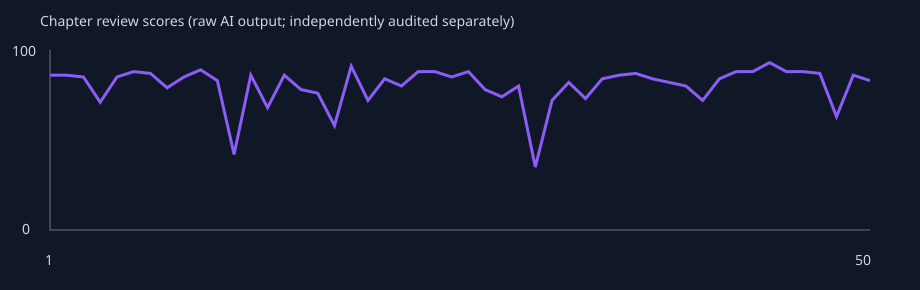

# Phase 4A — 50章检查点

快照时间：2026-10-30T05:35:53.376Z。真实DeepSeek、Supabase及产品服务；不是Fixture正文。**50章存储与分析链路完成，含第40章语义缺句；NOT READY FOR PHASE 4B。** 此文件记录测试成绩，不自动批准下一阶段。

本地私有证据：`artifacts/phase4a/stress-2026-10-21T07-27-33-712Z`。报告不包含账号或密钥，测试数据保留。

## 完整性与规模

| 指标 | 结果 |
| --- | --- |
| 正文 / 摘要 / 有效审核 | 50 / 50 / 50 |
| AI正文版本 | 50，每章1个 |
| 去空白字符数 / 纯汉字 | 272,168 / 229,227 |
| 2500–3500字达标章节 | 0/50 |
| Memory / active / resolved / obsolete | 533 / 522 / 11 / 0 |
| 人物 / 时间线 / 未解伏笔 | 27 / 191 / 58 |
| 审核均分 / Critical章节 | 80.22 / 4 |
| 显式步骤重试 / 独立检查后Critical继续 | 44 / 4 |

## 调用、Token及耗时

已返回用量的实际请求210次，遥测另记录1次无正常响应的请求；合计至少211次。生成日志216条还包含调用前拒绝，不能当作API调用数。累计已知输入8,570,889、输出1,665,698 Token；缺失用量不是零费用。没有硬编码人民币价格。

| 步骤 | 尝试 | 失败 | 输入Token | 输出Token | 平均 / P50 / P95 / 最大秒 |
| --- | --- | --- | --- | --- | --- |
| 正文 | 68 | 18 | 2,346,045 | 570,995 | 63.57 / 63.53 / 101.96 / 106.25 |
| Memory | 60 | 10 | 2,416,304 | 221,110 | 23.81 / 21.01 / 41.83 / 86.89 |
| 审核 | 88 | 38 | 3,808,540 | 873,593 | 57.70 / 58.40 / 95.83 / 105.81 |

已记录完整章节活跃步骤耗时：566.92 / 216.75 / 655.62 / 16241.02秒（平均/P50/P95/最大；不含人工检查、限额等待，早期遥测不全）。第9章存在主机/网络长中断，原始最大值保留，不当作正常模型推理耗时。

## 增长与质量趋势

| 章 | Memory | active | resolved | Writer输入Token | 提取候选数 | 提取请求字节 |
| --- | --- | --- | --- | --- | --- | --- |
| 1 | 15 | 15 | 0 | 2798 | 未记录 | 未记录 |
| 10 | 133 | 125 | 8 | 27579 | 未记录 | 122795 |
| 25 | 295 | 287 | 8 | 38926 | 116 | 127893 |
| 50 | 533 | 522 | 11 | 40650 | 101 | 137853 |

提取原始服务器合并索引不等于发送模型的上下文；候选最多120条/60KB，完整请求180KB限制不变。阶段区间内曾修复代码，不能把累计失败率外推为最终版本失败率。

| 章节区间 | 已写 | 均分 | Critical | High | Medium | 失败/尝试 | 原始水文风险均分 |
| --- | --- | --- | --- | --- | --- | --- | --- |
| 1–10 | 10 | 84.10 | 0 | 2 | 7 | 15/45 | 18.60 |
| 11–25 | 15 | 77.67 | 4 | 7 | 12 | 29/74 | 27.73 |
| 26–50 | 25 | 80.20 | 2 | 10 | 30 | 22/97 | 25.16 |

第13/14章水文风险分与文字评价方向相反；原始数字保留，不把量纲混乱解释为质量突然恶化。v5起区分质量和风险评分，v6在推理耗尽时采用一次无额外推理重试；报告返回成功不证明漏判已经消失。

## 独立抽检与记忆质量

抽检者为开发代理独立阅读原文，不是人类读者研究。要求抽检章节：1、5、10、20、30、40、50；尚缺：无。

### 第1章

- readability：场景、工作动作和对白具体，可读；早餐通勤篇幅偏多，商业核对有细节。
- character：谨慎核对而非轻信，苏宁维护原件权限，符合初始人设。
- plot：差异清单和缺角运单推进了任务，但没有执行章纲的能力边界验证；正文明确一次预见都未使用。
- style：结尾多次用明日计划和欠租提醒收束，略有总结重复；没有连续神秘来电或万能反转。
- dialogue：工作对话自然、具有权限边界，少量流程解释偏密。
- foreshadowing：蓝色缺角运单自然出现，尚未回收；另生成随印包装线索，后续需观察是否分散主线。
- reviewAccuracy：86分审核指出能力验证未落地，判断成立。原件保存主动性问题属于低等级执行偏差，未误判成Critical。
- goldenFacts：未发现明确违规，但24小时/十秒上限未在实际事件中展示，不能据此宣称已证明全部事实长期有效。
- memoryQuality：15条中有同义重复候选：四张缺角运单与连续号段；随印包装查询结果分别为secret和foreshadowing；待50条固定抽样量化。

### 第5章

- readability：运输员证言及导师旧底稿有具体动作，可读；通勤、备案、等待审批占比高。
- character：苏宁和陈砚谨慎区分证据与线索，符合人设；主角连续按流程核查，主动改变局面的行动偏少。
- plot：新增司机证言与三号底稿，但章纲要求周绍安换交接联得到确认、3000元到账均未落实，回收推迟；仅把同一问题改为进一步待核实。
- style：末段连续回顾已有线索、列明日清单、收到工作通知和设闹钟收尾；相较首章形成重复的工作日志结构。
- dialogue：司机只承诺说所见事实，导师提醒来源不明，人物口吻相对自然；多轮解释流程重复。
- foreshadowing：三号底稿引入合理，来源保持未知；蓝色缺角运单只推进未按第5章计划回收，不能报为成功回收。
- goldenFacts：经济状态失败：初始18000元、欠租6000元，第4章预计次日支付后不足4000，第5章付5000后剩3920.4；未交代9079.6元此前支出。末段预计3000到账、付剩余1000房租后只剩几百的算术也不成立。
- reviewAccuracy：审核发现资金缺口但仅判low。回读第4章修正：房租转完是未来预计，不是已付款，不计重复付租；来源不明余额缺口仍成立。

### 第10章

- readability：对账、导师书房、峰达仓库三个场景清楚；具体劳动动作自然，但材料编号和行程计划偏多。
- character：苏宁要求只写证据、郑闻山避谈辞职信、陈砚尊重梁静合同意识，人物行为基本自然。
- plot：房租尾款、两分钱证据交合规、辞职信露角、仓库分区均推进；财务推导本身错误破坏核心冲突可信度。
- style：再次以工作消息、次日行程和吃饭通勤收束，与第1/5章工作日志模式相近。
- foreshadowing：两分钱回收受错误算式影响；辞职信埋下且原因留白，长期伏笔未越期回收。
- goldenFacts：5920.4余额从第5/7章局部推演相符，但未修复初始18000元资金缺口；能力仍未使用，不能据此证明实际规则执行。
- reviewAccuracy：89分；真错11×0.02仅low，遗漏29笔金额上界；误报正确减法；将本章Memory视为既定数值，暴露自我验证风险。

### 第12章

- reason：Independent inspection of real Critical pause
- readability：签约、底稿与旧账户调查连贯，但合同六项与前章重复，章尾仍是次日待办；5631字明显超长。
- goldenFacts：GF12 FAIL：赵驰第20章才知能力，本章已明确知道；苏宁应本章验证后得知，实际仍未告知。两处知识边界错误，归属同一Golden Fact。
- plot：合同签署、九盏灯初现、三号底稿保险签字发生；能力告知和验证的主事件未发生。
- reviewAccuracy：42分，2Critical/1High核心判断成立；outline发现与苏宁Critical同一问题，不能重复计作第三个独立错误。
- foreshadowing：L2九盏灯账户按计划第12章埋下，未回收。
- contextFinding：第11章下一章要求只涉及合同/行程/对公账户；未发现显式要求苏宁继续不知情，不能将本次错误归因于这一字段。模型遗漏作者章纲并虚构赵驰知情历史。
- decision：Confirmed quality failure, preserved prose and review. Continue only controlled capacity/recovery measurement to25, retain all violations as failures. Not approval for publication, not an assertion of recovered story quality; no100 approval.

### 第16章

- readability：对账、查保险回执、仓库收尾三个具体场景可读；前约三分之一为成本和合作边界复盘，和前章工作日志模式相近。
- character：苏宁区分线索与原件、蒋姐提供自身保单、赵驰提醒报价边界，角色行动大体自然。但赵驰对白以第三人称说“给赵驰看过”，苏宁说“走的是苏宁个人关系”，有明显机械口吻。
- plot：寄件人外貌、8704保单、4471账户、方国栋与旧仓库地址推进线索；章纲要求确认旧案与现有货物重复报险，正文只建立地址及人员关联，没有确认同批货重复投保。
- timeline：15日晚至16日白天过渡清楚，上海内部移动有交代，未发现跨城瞬移或年龄变化。
- arithmetic：时薪70元乘每天10小时为700元，却称一天不到240；合同周期三个月却按两个月160小时算时薪，遗漏一个月。月薪8000多/176小时约45–51元，70元称高二成缺乏准确依据。
- foreshadowing：中期保险线推进但未确认收款人和寄件人，新增3条未解问题；未到长期伏笔回收期。末尾再一次把线索汇总为明日待办，接近此前模板。
- memoryQuality：新memoryUpdates成功保留4条旧伏笔的类型与active状态，但同一寄件线索仍同时进入plot和foreshadowing。新信息依据来自正文，某些E片段只覆盖复合描述的一部分；逐字证据存在不等于所有语义受证据支持。
- reviewAccuracy：v6首轮仍incomplete，第二轮none返回78分。指出重复核算成立；未发现70元每小时/一天不足240元、三个月合同只算两个月的错误。将同批货重复报险误判为已落实；仍用本章派生Memory证明本章正确，且把苏宁尚未知能力误称符合Bible，忽略第12章后应知情。引用了一条与重复核算无关的伏笔标题；逐字证据校验通过仍不代表证据相关。风险分filler25/repetition35与文字方向一致。可用性恢复不等于审核质量通过。
- goldenFacts：未新增已确认Golden Fact违规类别；未使用能力，不能据此证明能力边界已充分落实。已有12–14章知识边界失败仍成立。

### 第20章

- readability：合伙人争执、能力说明、仓单扫描、盘库有具体行动。对白大体自然，但规则被解释、签署、短信确认多次，末段再度用待办清单和明日预约收尾。
- character：赵驰要求平等知情、拒绝替他决定个人事务符合伙伴成长；陈砚承认先承诺后报备的问题合理。赵驰在正式讲能力前已写出能力限制条款，承接既有提前知情，不能据此倒改12–18章为符合Bible。
- plot：落实了能力详细说明、合伙边界和红桥仓单印章缺口高清存档。章纲要求验证后接受，但预测的是明天漏水，正文尚未兑现，询问不能读心/看标签不是对未来预测的验证；赵驰先说“好，我信了”再说“还得做验证”，流程未完成。
- consistency：同段先称带来一份复印件、随即称摊开的是原件，来源和物品身份自相矛盾。一张双方已签字的A4纸撕成两半却称一人一份，不等于两份完整协议。
- ability：明确未来24小时、每日两次、每次10秒，本章使用不足5秒并头痛，核心上限在本次场景没有明确超越。新增“没有声音/文字、看不到任何数字金额号码”的绝对限制并非初始Bible给定，需结合历史实际预见核验，不当作已验证核心设定。预测“明天”未说明钟点，不能仅凭词语确认是否超过24小时。
- timeline：结尾文件名明确2027.3.20，主要场景从午后延续至日落，在同一仓库与地铁步行范围，未发现跨城瞬移或本章时间倒流。
- foreshadowing：L1红桥仓单在计划第20章推进：记录印章左下缺口，双方分开备份；未揭露长期来源，不能算回收。档案“复印件/原件”混用会削弱后续证据链可靠性。
- style：“清单、规矩、签字、明天”反复出现；情感落点仍被制度说明取代。优于纯总结但节奏拖长，场景尾部可合并。
- reviewAccuracy：审核72分，high识别红桥原件归属冲突，medium识别上午约定变下午及知情前写能力条款，均有依据。未指出预测尚未兑现即相信、单张签字纸撕半当两份、无声音无文字等新增限制；不能用72分概括全部风险。人物knowledge已正确保存本章明确讲出的规则，但其中新增限制也随之进入下一章。
- goldenFacts：GF12历史提前知情仍失败；第20章补讲规则未修复过去，验证后才接受也未真正完成。GF03/GF05本场景边界有明确表述及代价，其余长期事实不能仅凭本章无关键词宣称全部PASS。
- generationMode：Explicit same-input retry after AI_INCOMPLETE, reasoning none; original failed attempt retained.

### 第22章

- readability：完整独立阅读。查询码带来新的取证方向，豆浆对话自然；正文大量复述材料流转、进度与明日待办。此为开发代理抽检，不是人类读者评价。
- progression：M2匿名保险回执按22章计划推进到第三方系统查询手续，尚未回收；M1底稿约定次日交付，24–25是否按期回收仍待检查。L2九盏灯明确尚无进展，25章才是下一推进点。
- confirmedTimeline：本章明确从2027年3月21日晚进入次日3月22日，却写“3月24日（周一）前”及“后天是周五”。实际2027-03-24是周三；两处为同一日历连续性类别的明确错误，不是两条Golden Fact能力违规。
- continuity：从21日夜到22日早晚的顺序本身正常；两次仓库场景发生在相邻两天，不应仅因相似场景判为日期倒流。8:30通话后出门坐地铁、13:30到总部缺少中间活动交代，属于节奏/时间空白，非证明交通不可能。
- knowledge：本章未实际使用预见能力，不能据此判定全书能力规则PASS；未新增韩世衡知情证据。人物状态及关联记忆可能由本章提取，不能拿它们作为独立历史证据。
- repetition：四线进度至少在苏宁对话、仓库转述、结尾心理再述；明日拿底稿及送衡川反复写入对白/备忘录，信息增量递减。
- reviewAccuracy：最终v9真实审核80分，low首轮完整返回，正确抓到3月24日星期标注相互矛盾；另提示2009审计与2010上半年说法冲突，需对照原始审计/内部复核事件区分。此前失败返回曾把两天正常仓库会面误判重复日期，均保留但不计为正式审核。temperature=0的none备用分支在本次成功调用中未触发，不能把成功归因于降温。

### 第23章

- readability：完整独立阅读。竞价场景有具体规模、报价和交付边界，梁静输单但维持合作口径较自然，章纲小试点胜出已执行。结尾再次密集罗列工作清单与赵驰的“行”。
- continuity：22章约定23日上午取底稿、下午送衡川；23章未执行，却回顾说“韩姐看了，格式没问题”，将未完成交付提前当成已确认结果。该跨章跳步比只说“未交代排期”更明确。
- timeline：23日是周二，正文反复说“后天周五”错误；瑞和已签“周一进场”后又排“明天下午第一次现场”，同一项目开始日期冲突。峰达现场最后一天/明天收尾/第一周验收明天交/第二周验收周五交也混杂，不能把全部说法自动计成独立错误。
- character：陈砚与赵驰提前报备、梁静接受有限试点结果，属于合理协作与竞争；不等于人物性格漂移。没有实际预见使用或韩世衡获知能力的新证据。
- reviewAccuracy：正式88分报告抓到旧排期未落实、瑞和进场冲突、验收日期混乱。High排期问题与Medium衔接问题重复指向同一事实，独立统计只记一次；遗漏“韩姐已看”将未完成交付当结果。分数偏高，仍不能用分数当长期一致性证明。

### 第24章

- readability：完整独立阅读。签批、师徒取件、仓库收尾、信息互换各有具体行动，但近六千字仍长，晚间多次重述进度清单。
- continuity：郑闻山明确“你拿两份，仓储线和外包服务费线各一份”，陈砚随后发消息称“四份拿到”，衡川却登记三份；终结小结留在郑处虽解释了四变三，仍未解释二变三。同一物品交接数量不一致。
- timeline：郑称1999–2001年红桥审计时周经理说过一句话，结尾称“十七年前说这话的人”；2027距1999–2001为26–28年，并非17年。与2009审计/2010复核混用的更大问题需分别追踪，不能把所有年份句子合并为已证明同一事件。
- foreshadowing：M1在24章仅取得签批复印件，原件缺失且无经办人证言；章纲本章证实转付的要求未落地。25章周绍安自认签批才形成部分回收。
- reviewAccuracy：88分审核准确抓到章纲证实未完成，却漏掉交接两/三/四份和十七年前矛盾。旧人私下查档案与回避谈旧案可以并存，low人物建议不应当作确定性格漂移；本周内提前答复也不应计成确定时间冲突。仍用本章派生Memory作一致性证明。

### 第25章

- readability：完整独立阅读。验收、签说明、预审、试点开工逐项发生，推进明显；主角没有靠新增能力取胜，合作边界与报价调整自然。流程对白仍密集。
- continuity：韩姐要求陈砚14点旁听并记录，他明确答应，随后在瑞和工作且由苏宁转述约谈，未交代改派。24章每日下班抽五货位的自检要求，25章交付操作卡变成每周三下午抽五个，无变更说明。
- money：复核14章原文已明确第二周单独再谈、报价五千；25章到账五千不能仅凭9章旧总预算Memory判错。旧Memory未标失效造成审核误报风险，不计新的GF10违规。
- foreshadowing：M1周绍安承认签批，第一阶段责任链得到部分收束；原件与最终款项去向仍缺，不能称所有旧案都已回收。L2九盏灯本应25推进，却只说还没动/只有尾号。L1长期仓单尚未到70–72回收窗口。
- reviewAccuracy：85分审核命中旁听任务悬空及九盏灯推进缺失；款额问题遗漏14章重新议价，不算已确认错误。未抓24到25抽检频率改变；未使用能力不能证明所有能力规则已验证。

### 第30章

- readability：完整独立阅读5101个去空白字符。档案前台、行政部和外包保管人的对白有各自权限边界，行动可理解；但主要篇幅围绕申请、复述、明天计划，悬念和人物冲突被手续替代。
- plot：章纲规定的合法会议、陈砚主动向韩世衡展示并承认能力、为赵驰承担代价全部缺失。正文推进衡正登记簿查询到次日许可，属于旧支线的又一次准备；标题秘密的代价未落地。GF07的第30章确证里程碑未执行，人物韩世衡knowledge仍为不知道。早于30章知情与到30章仍未完成是不同检查项。
- timeline：29章从3月29日进入第二天上午9:40见孙茂林，晚上对账并安排次日去衡正；30章却回到3月30日7:50，在已知孙茂林线索的前提下去衡正。非明确倒叙且两段上午行程/因果冲突，确认失败。审核critical时间线与high衔接描述同一事件，独立计数不重复。另26章下周二即3/30已见启衡，28章3/28写会后回复，是另一组倒流。
- ability：本章一次七秒预见、头痛和休息符合次数/单次/代价。上午预见查阅室，许可仅次日下午13时后，疑似超过24小时；30章尚未真正查阅，先列WARNING，待31章是否明确兑现再判GF03，不能把计划时间当已发生事实。
- character：赵驰要求报备和不硬闯、苏宁要求走权限流程与初始谨慎协作基本一致；并非所有重复管束都算性格漂移。导师补充划改痕迹提供新线索。
- foreshadowing：M3辞职信转向登记簿，顾姓经办人、划线登记尚未解；M2回函仅再次改为周四预计到。没有长期伏笔成功回收。
- style：五条/六条查阅计划反复电话、备忘录、另纸、电脑盖抄写，结尾仍是明天还有明天的活；工作日志式重复明显。
- reviewAccuracy：35分审核正确抓到时间倒流、关键披露缺失、手续水文与报备重复；24小时项目保留疑似更稳妥。原文、Memory和critical报告全部保留，继续50章仅测容量和恢复，未批准质量或100章。

### 第31章

- inspectionScope：针对日期、能力兑现、档案实物和知情段落的独立核查；不冒充额外整章文学抽检。
- goldenFacts：GF03确认FAIL：30章明确3/30上午在衡正门口预见查阅室和灰蓝硬壳簿子，31章3/31 13:05进入查阅并明确簿子和预见一样、房间堆箱也对应。即使按上午结束前最晚时间，仍超过24小时。30章原疑似在31章有实际兑现证据后升级，不以30章计划代替事实。
- continuity：2009簿子中先读到2010年1—3月登记，随后又称每年开新册、2009箱只有2009内容；2010年册又有同一登记。确认局部档案物品/年代规则矛盾，不是新超自然世界体系。团队结构回复开头今天8:40才发，中段苏宁说昨天发，为另一时间措辞风险。
- plot：韩提出预见商业化、陈砚拒绝保证收益、苏宁评估披露后风险均未执行，继续用上一章查档待办替代当前章纲；30章缺失导致31章计划链进一步偏离。
- reviewAccuracy：正式72分审核命中未执行章纲和两本年度簿册矛盾；没有报告GF03实际超24小时兑现。高分或有效JSON仍不能证明核心限制有效。

### 第33章

- inspectionScope：定向核对付款原文及正式审核，不冒充全文阅读。
- money：32章瑞和首笔6500、第二笔5500、总价12000，33章第二周实际6500且说按合同不调整，没有解释多出的1000；确认跨章财务冲突，属于GF10后续收支有来源约束的复现。
- reviewAccuracy：v10真实恢复为73分；高风险章纲缺失这次包含本章正文证据，付款差异为medium。修复的是引用契约，不表示消除了内容矛盾；旧失败返回保留。

### 第35章

- readability：全文4326个去空白字符。报价结构、竞争边界和奖励条款有具体得失，赵驰的建议自然；但多数场景都是批注、改邮件、再确认、写明日计划，缺少实际项目冲突的结果。
- plot：梁静确认模板格式、各自报价和不互相评论，陈砚发单方签章扫描件，对方签章仍待回传。不能等同双方已完成项目级合作；赵驰继续批注与调Excel，没有明确接任一部分项目负责人职责。
- foreshadowing：M2回收窗口33–35已结束。33追九盏灯和保单，34比对重复投保并发现退费截走，35转模板与委托；未查明匿名保险回执的寄信人/目的，没有退款场景。34已证明的为外包人员重复投保而非原计划同批货重复报险，叙事因果沿已生成支线偏离作者计划。不能把找到三张保单当作回执整条线已回收。
- character：七人基础性格仍可辨：赵驰务实、苏宁审慎、梁静维护竞争边界。苏宁自行提出相似异议条款可以是专业判断，不应仅因与赵驰建议相同就判读心或知识泄漏。
- timeline：主要一天从8:40到夜间上海通勤顺序清楚。16:15说已发蒋姐简版，17:40又记明天发蒋姐和老周，属于已完成待办反复出现的轻微状态矛盾；不虚构为跨城瞬移。
- style：收费页批注、邮件三点、签章、合规口径、复盘问题清单反复转述；结尾再次逐条明日安排并以文件袋里的纸张总结，有工作日志式重复。可读不等于适合持续网文节奏。
- reviewAccuracy：86分报告发现现场抽查收费范围可能重复及合作仅为模板，均值得核对；将有明确专业理由的单独页改合并页列low只是版本建议，不计确定错误。没有指出回收窗口结束仍无M2来源/目的，也没有明确赵驰负责人的缺失；不能用分数证明长期计划得到执行。
- goldenFacts：本章明确未使用预见，不构成能力越界新例，但也不能证实能力规则长期通过。GF03/GF07/GF10/GF12此前失败不因本章无新违规消失。

### 第39章

- inspectionScope：定向原文核对资金及启衡复盘日期，非全文文学阅读。
- money：39章把瑞和第二周已到账金额写为12000；33章实际转账6500，32章原合同第二笔5500。确认同一第二笔的金额再次漂移，不能把总合同价当成同一笔到账额。GF10仍FAIL，原数据未改。
- timeline：32章4月1日方琳邮件明确下周三下午两点，即4月7日。33–36多次延续该计划；37–38没有实际复盘或改期说明；39章4月8日仍称下周三，滑至4月14日。定向搜索32–39相关段落未见改期，确证相对日期持续后移的一处事件。
- reviewAccuracy：80分正式审核命中瑞和金额和核心保管制度缺失，并以low提示复盘日期；独立日期对照支持这一问题。将库中旧错误6500称已确认记忆不能修复32→33的原始1000差额。

### 第40章

- readability：完整独立阅读5760个去空白字符。查阅授权、贴标签、面馆、印章比对场景可理解，人物对白具有职责边界；多次重讲同一比对方法与结论，邮件/备份/清单占比仍高。
- plot：确实重新调用20章赵驰保存的扫描，说明早期线索仍能进入40章；但章纲要求缺口与旧企业章对应、证明来源真实，实际三份文书均完整、比对不能认定同一，计划事件未完成。不能把只提到旧线索当作执行了计划。
- foreshadowing：L1在40章得到调查推进，未揭旧案全貌；对应联变成新增待查事项，来源真实性仍悬置。尚未到70–72回收窗口，不将本章比对尝试称为长期伏笔成功回收。
- continuity：韩姐明确三份是当年留存的复印件，末尾却写把三份原件叠回档案袋，同一组实物身份矛盾。比对不能认定、折痕/撕裂边仍有多种可能，但结尾陈砚已“知道章没问题”，赵驰也说“知道缺口不是章的问题”，将未证实推断收紧为事实。 对照20章原文，印章明确左下角缺口，本章改右下角，证明早期事实虽被重新调用仍发生细节漂移。
- completeness：正文最后是“在最后一行底下加了一句话：”，后面没有那句话。API标completed、服务端非空/大小校验通过不代表语义上写完一章；该已保存缺句保留，不补写或隐藏，单独记质量失败，不混入API失败次数。
- character：苏宁、韩姐、赵驰都强调证据边界，基本人设保留；最后把可能说成知道与前面审慎态度相悖，属于证据推断失控，不等于凭空新增读心能力。
- timeline：开头7:40后回述清早活动是明确回顾，并非日期倒流。2027-04-09周五标注正确，主要上海场景有出行与时间；不因实际提前去仓库就自动统计瞬移。
- style：同一个缺口至少在陈砚思考、苏宁电话、韩姐电话、午饭、比对、苏宁会谈、赵驰电话、说明三段和末尾清单中重述。章纲事件未兑现却用另一联待查延长支线，工作日志式重复风险高。
- reviewAccuracy：正式审核72分，命中章纲方向相反、前章4/8误写周二、原件未送到现场、20章左下缺口变40章右下。独立原文复核确认20章明确左下、39章明确今天周二；40章4/9周五本身正确。审核未发现本章三份复印件变原件，也未报告最终冒号后的缺句。提前贴标签缺少改期说明只计建议，不当作确定时间硬错。
- goldenFacts：本章未展示能力使用，无新增已确认能力越界；不能据此将此前GF03/GF07/GF10/GF12失败改成PASS。早期扫描回调成立，但来源与实物身份仍需核对。
- memoryQuality：成功记忆保留推测、可能等限定，未把对应联自动标已找到；已有剧情条目通过memoryUpdates保留原类型。引用契约修复有效，不代表消除全书记忆污染。

### 第43章

- readability：全文4908字独立阅读。报告定价错误、主动认错与客户修复构成可读场景，但退五百/报告质量控制/次日补材料在对话、邮件、清单中重复，尾部大量复盘。
- plot：服务过失被具体展示，客户关系保留过顺是合理编辑建议；退款承诺不是退款已经执行，作者结尾却把客户先付定金的入账截图当作自己已退五百的依据。
- continuity：下午明确明日退款、19:30仍未转，随后只有峰达向陈砚划五百定金，末尾却记已退五百。这是款项方向及完成状态错误，不能以客户愿意继续合作消除。
- timeline：4月12日2027年应周一，承接42章周日次日审计，赵驰却说今天周五。审计10:40结束、待1小时40分恰好9:00开始，没有审核所说的进场时间冲突。
- reviewAccuracy：88分。审核准确指出修复偏顺、说教和重复，但把正常9:00–10:40审计标medium，漏掉实际周一/周五与未转即已退。42章周日的下周一和明天也指同日，不计为独立时间线错误。
- goldenFacts：资金完成状态错误延续GF10失败；新增一处时间线问题，不凭借无能力场景宣布能力长期通过。

### 第44章

- readability：独立完整阅读5215字，查到辞职申请及同期情况说明，手续/授权有具体行动，随后多次复述同一发现与次日清单。
- plot：M3在44章找到登记对应原件和拒签原因，45章正式陈述形成阶段回收；不能当作L1/L2长期主线回收。
- continuity：仍复述第二周12000的旧错误。上午四项打包发出，晚上又说第四项未做；档案背面写复印件交本人，推断未留底并无充分依据。
- reviewAccuracy：93分过于乐观，所列明天清单次日收到不构成时间矛盾，未发现旧金额延续和已发事项重复。

### 第45章

- readability：完整阅读6019字。郑闻山从拒签辞职到正式作证有合理成长；反复讲程序走完、共享清单和明日安排，削弱场景推进。
- plot：正式签字入卷完成M3阶段性回收，原件仍在档案公司，查询授权不是原件转交。跨4月14–15日清楚交代，不能仅因跨日统计倒流。
- continuity：郑闻山已将四页复印件放进公文袋离开，后面却重复待取给他；21时已发补充申请，又在清单和结尾说明早先发，形成完成状态冲突。
- reviewAccuracy：88分抓到大纲单日偏差，却漏掉已交复印件/待取和已发申请/次日再发。三个人对应三份来源本可成立，不计硬错误。

### 第48章

- readability：独立完整阅读保存前同一次成功writer返回，盘库/食品包装客户量库可理解，但反复共享清单和次日安排，主线被日常工作替代。
- plot：全章未推进九盏灯账户的48章指定节点，转为冒名邮箱回执和新客户量库；不能把一般经营推进当L2推进。
- timeline：1:50盘完、随后登梯20分钟，离开却回到1:40，无倒叙说明。
- continuity：本章说今天没用预见，结尾却将46章相似灰档案袋场景复述为今天，旧场景重复进入当前总结。
- reviewAccuracy：独立阅读时尚未完成正式审核，后续分数单独记录。

### 第50章

- readability：独立完整阅读本次成功Writer正文，仓库核数、经营结算、审计中期意见的行动可理解，较前文短；反复已做清单、下周待办和未来一月安排，章末多次追加备忘录，工作日志式重复仍高。
- plot：中期报告确认当期试点且留下旧案待核，主角仍普通创业者，红桥与九盏灯未强行提前回收。经营可维持的结论依赖错误账目，不能视为现金流目标可靠达成。
- finance：48章按每日1600、4–6天报价，50章按实际两天却总价6400，缺少单价/计费变更。12000+3500+3200+3200应21900却写12800；峰达1400约定周五收，随后计入已到账20100，待收错算为已收。
- character：陈砚谨慎对账、赵驰约束边界的形象总体保留，但双方互认错误总账，与实际核数能力冲突。主动免费看软件未展示先经赵驰确认，作为规则执行风险，不单独计确证世界/能力错误。
- timeline：4月19日2027确为周一；49章由前文推得也在19日而50写次晨存在顺延疑点，保留WARNING，不靠大纲单日偏差新增确证计数。瑞和到账又变4月15，与44章4月8表述不一致，作为原款项历史漂移证据。
- foreshadowing：L1/L2结尾明确仍待对应联和银行二次协查，不构成长期回收。M3的44–45阶段回收不应被抹去，但不能代替70–90长线测试。
- reviewAccuracy：全文独立检查先于正式审核完成，后续审核命中/遗漏需对照实际结果。
- goldenFacts：GF10资金族再次失败；本章未用能力，没有新增确证超24小时，但不消除30–31的历史失败。

固定50条记忆独立样本来自第4章，分类和证据保存在memory-audit-ch4.json，不能冒充本检查点的重新抽样。样本文件包含原始分类及理由条/项；具体比例见10章报告。跨类型同义及行内重复仍可能存在，主键或逐字无重复不能证明语义无重复。

## 独立评估的口径

抽检由开发代理独立阅读正文完成，不是生成模型自评分，也不是人类读者实验。问题台账按同一事件去重；分类互斥，Golden Facts与分类重叠，不能相加。确证数量为下界，不表示逐句审过全部章节。42章“下周一/明天”和43章9:00开始、10:40结束均成立，未把审核误报算入错误。第4章付租为未来计划，已更正早期“重复付款”判断。

**存储链路完成不等于正文语义完整：第40章以“在最后一行底下加了一句话：”结束，实际句子缺失。** 原始正文、版本、失败日志均保留，未补写掩盖问题。所有章节应按独立质量验收结果判断是否可发布。

## Golden Facts

下表综合正文检索、指定全文抽检、状态快照和正式审核；PASS仅表示本轮覆盖证据未见冲突，WARNING表示关键边界未充分实际触发，不以无关键词命中证明长期正确。

|事实|结论|正文、记忆及审核证据|
|---|---|---|
|GF01 主角陈砚姓名固定|PASS|抽检主角称谓和人物主记录保持陈砚；第8章吴/温永强是配角错误，另计。|
|GF02 27岁、1999-12-18出生|PASS|初始人物年龄/背景未改；2027年春季故事无需跨生日增龄。|
|GF03 仅未来24小时、亲身经历|FAIL|30章上午预见档案室，31章次日13:05明确兑现，超过24小时；72分审核漏判。|
|GF04 不预测彩票/精确股价|WARNING|设定仍在Bible；抽检未见相应越界，但缺实际边界试验，不能认为压力验证充分。|
|GF05 每日两次、十秒、有代价|WARNING|13章实际使用呈现次数和代价；大量后段章节不使用能力，无法仅靠无违规检索验证长期上限。|
|GF06 苏宁28岁普通风控经理|PASS|基础身份保持，行动以风控/证据判断为主，未证实其他能力。|
|GF07 韩世衡30章才获能力确证|FAIL|30章核心揭示事件缺失，31章前提谈判亦未发生；属于里程碑缺失，未证明30章前提前知情。|
|GF08 无其他超自然体系|PASS|抽检商业/审计情节未出现新超能力；20章额外限制作为WARNING，不误算成修仙体系。|
|GF09 公司主体独立|PASS|砚行、衡川、峰达、瑞和主体仍区分；付款错误另计，非公司合并。|
|GF10 资金初始18000、欠租6000、变动可追溯|FAIL|5章资金缺口、10/16章算术、32→33→39章第二周费用5500→6500→12000；43章尚未转出退款却记已退。审核有命中也有漏判。|
|GF11 上海及合理移动|WARNING|指定抽检多有骑车/地铁/出行过渡，无已确证瞬移；25章错过约谈是日程错误，不夸大为同时两地。|
|GF12 赵驰20章知情、苏宁12章验证后知情|FAIL|赵驰12章提前知道，苏宁12章选择不告知；20章赵驰知识后被最新事项覆盖。Critical命中部分，后续仍复现。|

确证4类Golden Fact失败；GF12含两个人物里程碑，资金多次错误只算同一事实族，不能将4类当成4个错误段落。

## Memory、知识与污染

第4章固定随机50条样本：有价值27/54%，重复15/30%，错误1/2%，过期4/8%，细节2/4%，无法验证1/2%。第25章独立固定随机50条：有价值24/48%，重复12/24%，错误3/6%，过期10/20%，细节1/2%，无法验证0。两批不是同一队列，不能称重复率已从30%改善到24%；也不能冒充50章重新抽样。逐字重复为零不等于语义重复为零。

已完成的“明天”仍active，错误推断可能升级成确定事实；提取证据逐字存在只能证明出处，不能证明推断成立。knowledge字段现已能更新，但最新清单覆盖既知事实、角色获取读者全知信息仍存在。25章郑闻山获得会面后事件信息无通知过程，赵驰20章知能力在25/33状态中丢失。人物基本性格字段未修改，不代表知识状态可靠。

记忆历史不删除，resolved/obsolete不作为一般活跃候选；服务器完整索引仍用于防重复和防复活。仍active的过期事实无法靠状态过滤解决。需要可审计的事实修订、知识增量账本和污染隔离，尚不能声称系统性问题已修复。

## 伏笔与剧情

|线索|计划与观测|
|---|---|
|S1/S2/S3|5/8/10章短线回收未全部按约完成；S3资金核对还存在算术错误。|
|M1|24–25章只有部分承认；原始寄件人和资金去向尚缺，不等于完整回收。|
|M2|33–35回收窗口错过；调查转成保险比对/模板流程，未完成寄件目的及退损。|
|M3|44章查得辞职申请及同期情况说明，45章正式作证签字，阶段性回收成立。|
|L1|20章扫描到40章仍被调用，但印章缺口左下变右下；40章无法证明同一来源。70–72回收窗口尚未到，不宣称长期回收成功。|
|L2|25章未按计划推进，33章查到户名/银行只是子线；48章全文改写成邮箱回执与新客户量库，未落实九盏灯推进。85–88回收窗口尚未到。|

resolved Memory数量是数据库状态，不能当作成功回收同等数量的人工规划伏笔。M3阶段回收不代表100章长线能力已经验证。

## 公开部署前必须解决

1. 建立带出处和生效时间的持久知识增量，防止旧知情丢失与全知信息泄漏；对不确定推断、错误/过期记忆隔离和修订。
2. 增加时间、金额、能力边界和章纲里程碑的独立检查；同一事实跨章一致性不能只依赖生成模型自审。
3. 约束篇幅，检查语义完整性与已完成待办，减少反复清单、模板对白和延迟主线。
4. 降低推理耗尽、无效结构及重试成本，并在修复后重新进行同条件长篇验收；现有尝试失败率混合多个版本，不能外推最终版本SLA。
5. 将小说详情中的全部正文与记忆历史拆分分页读取；列表优化和一次详情请求不等于百万字规模已通过。

**NOT READY FOR PHASE 4B。停止于50章验收，不进入100章或公开部署，不开发会员/支付。**

## 人物字段快照与固定记忆样本

| 初始人物 | 姓名/年龄/性格/背景/身份变化 | 关系记录数 | 当前地点 |
| --- | --- | --- | --- |
| 韩世衡 | 基础字段未变 | 0 → 0 | 上海 |
| 郑闻山 | 基础字段未变 | 0 → 0 | 上海，衡川物流十二楼（谈话后离开） |
| 陈砚 | 基础字段未变 | 2 → 97 | 上海，骑车离开办公室途中 |
| 苏宁 | 基础字段未变 | 0 → 3 | 上海 |
| 周绍安 | 基础字段未变 | 0 → 1 | 上海 |
| 梁静 | 基础字段未变 | 0 → 0 | 上海 |
| 赵驰 | 基础字段未变 | 0 → 1 | 上海，离开办公室 |

基础字段未变不代表人物知识、关系和行为一致；成长与错误须按独立原文抽检区分。关系记录增加也不等于发生同等数量的真实关系变化。

第4章固定50条样本：

| 分类 | 条数 | 占比 |
| --- | --- | --- |
| 有价值 | 27 | 54% |
| 重复 | 15 | 30% |
| 错误 | 1 | 2% |
| 过期 | 4 | 8% |
| 过度细节 | 2 | 4% |
| 无法验证 | 1 | 2% |

## 确证问题下界

| 主分类 | 独立事件数 |
| --- | --- |
| character | 6 |
| timeline | 12 |
| world_item | 6 |
| ability | 1 |
| finance | 13 |
| plot_continuity | 7 |
| prose_completeness | 1 |

原文证据、去重规则及排除项见私有independent-issues.json。并非审核finding数量，不代表全部问题。

## 初始至50章人物对比

| 人物 | 性格/背景/年龄基础字段 | 关系条目：初始→10→25→50 | 能力与状态 |
| --- | --- | --- | --- |
| 韩世衡 | 保持 | 0 → 0 → 0 → 0 | 业务状态变更不自动等于人设漂移 |
| 郑闻山 | 保持 | 0 → 0 → 0 → 0 | 44–45正式作证有成长；25章全知泄漏 |
| 陈砚 | 保持 | 2 → 18 → 50 → 97 | 谨慎经营有成长；能力24小时越界已确证 |
| 苏宁 | 保持 | 0 → 1 → 1 → 3 | 业务状态变更不自动等于人设漂移 |
| 周绍安 | 保持 | 0 → 1 → 1 → 1 | 业务状态变更不自动等于人设漂移 |
| 梁静 | 保持 | 0 → 0 → 0 → 0 | 业务状态变更不自动等于人设漂移 |
| 赵驰 | 保持 | 0 → 0 → 0 → 1 | 业务职责增长合理；旧知情覆盖仍有风险 |

关系数增长包含重复事项，不是同等数量的新关系；current_state是最新投影，历史保留不能保证当前模型收到全部已知事实。

## 重复、长度与质量趋势

| 窗口 | 词项候选 | 章节数 |
| --- | --- | --- |
| 开头120字符 | nextMorning | 30/50 |
| 开头120字符 | backToCompany | 0/50 |
| 开头120字符 | phone | 18/50 |
| 末尾250字符 | phone | 4/50 |
| 末尾250字符 | door | 1/50 |
| 末尾250字符 | stranger | 1/50 |
| 末尾250字符 | smirk | 0/50 |
| 末尾600字符 | nextDayPlan | 42/50 |
| 末尾600字符 | listOrRecap | 39/50 |

这些是固定词法窗口命中，不等于语义重复判决。最近5/10/20章摘要已另行独立核查，详见阶段结论。正文目标2500–3500按产品去空白字符统计；纯汉字另列，避免用同一“字数”混淆口径。

## 50章云端浏览器验收

证据：`browser-2026-11-02T00-33-56-875Z.json`，11个路由各两次，0 error、0 warning。

| 页面 | 轮次 | 加载秒 | 小说详情请求数 | 详情响应字节 |
| --- | --- | --- | --- | --- |
| / | 1 | 2.67 | 0 | — |
| / | 2 | 1.99 | 0 | — |
| /create | 1 | 4.09 | 0 | — |
| /create | 2 | 2.40 | 0 | — |
| /novel/[id] | 1 | 9.19 | 1 | 2701204 |
| /novel/[id] | 2 | 6.25 | 1 | 2701204 |
| /novel/[id]/outline | 1 | 6.78 | 1 | 2701204 |
| /novel/[id]/outline | 2 | 5.36 | 1 | 2701204 |
| /novel/[id]/characters | 1 | 6.24 | 1 | 2701204 |
| /novel/[id]/characters | 2 | 5.73 | 1 | 2701204 |
| /novel/[id]/world | 1 | 6.40 | 1 | 2701204 |
| /novel/[id]/world | 2 | 6.09 | 1 | 2701204 |
| /dashboard | 1 | 2.34 | 0 | — |
| /dashboard | 2 | 2.31 | 0 | — |
| /novel/[id]/memory | 1 | 6.19 | 1 | 2701204 |
| /novel/[id]/memory | 2 | 6.11 | 1 | 2701204 |
| /novel/[id]/timeline | 1 | 6.51 | 1 | 2701204 |
| /novel/[id]/timeline | 2 | 5.66 | 1 | 2701204 |
| /dev/novel-health?novelId=[id] | 1 | 5.68 | 0 | — |
| /dev/novel-health?novelId=[id] | 2 | 5.98 | 0 | — |
| /novel/[id]/chapters | 1 | 19.16 | 1 | 2701204 |
| /novel/[id]/chapters | 2 | 9.43 | 1 | 2701204 |

开发模式与网络波动会影响耗时，两轮不能作为生产P95。AI写请求被拦截；匿名登录保护、B不能读取A、重新登录恢复均通过。详情仍读取全文和记忆历史，尚未证明百万字性能。015只新增轻量列表RPC，使用已有novels_owner_updated_idx/chapters_novel_sort_idx，没有新增索引。

## 最终代码回归

最新修复后lint、生产build通过（build-2026-10-30.log）。正文12、Memory11、连续任务12、审核22组通过；数据库/仓储/AI基础回归通过。浏览器8项综合回归通过（browser-fixture-2026-10-30T05-31-56-667Z），含连续3章、刷新/断网/关闭恢复及账号隔离。真实普通小说云端SDK cloud-2026-10-29T07-41-08-132Z-c583569a通过双向RLS、保存/版本/重新登录/冲突/source引用约束。生产健康页404，安全扫描210源文件/29浏览器资源通过。没有密钥、密码或私有原始证据进入Git。

## 近期摘要的独立语义检查

最近5章（46–50）围绕补申请、等待意见、盘库、对账和下一日清单循环；47章冒名谈判和50章试点意见确有推进，但48章九盏灯指定节点未落实，49章七人谈判被分散日常替代。46章灰档案袋片段在48章末被重复成当天行为。结论：重复风险高，不能用字面相似度低证明情节新颖。

最近10章（41–50）中44–45的辞职原件及正式作证是真实推进；其余反复“整理材料→苏宁审核→韩姐许可→待补资料”。同一链条有合理程序，也有已完成事项重新待办，不能把全部手续都算水文，仍需削减复述。

最近20章（31–50）反复查档/保险回函/对表/备案/盘库。人物职业行为总体一致，但经营日常挤占指定主线，30–31披露与谈判缺失后未自动回到章纲。审核均分84.10→77.67→80.20，并非持续下降；后段评分回升也未消除独立确认的资金、日期、物品和记忆问题。原始水文风险18.60→27.73→25.16含早期量纲错误，不能当成可靠改善证据。

## 最终补充核验

第50章正式83分审核识别12800的金额矛盾，但称其余账目正确，遗漏每日1600的两天总价、峰达待收计已收，以及47章明确应付澄明2400变成50章应收。50章人物陈砚/赵驰的knowledge还写入错误已到账/待收总额，证明问题进入下一章可用记忆。原文和错误状态保留。

2026-11-02以测试所有者authenticated身份、只读事务测量数据库，不使用CLI管理角色绕过RLS：

| 查询 | 执行毫秒 | 返回行/说明 |
| --- | --- | --- |
| 完整小说详情RPC | 368.391 | 1个聚合结果；临时块读写各317 |
| 轻量列表RPC | 6.127 | 1个聚合结果，无临时块 |
| active记忆第一页 | 2.552 | 500行；不冒充全部522行 |
| 章节元信息 | 0.427 | 100行，包含50个未写大纲，使用索引 |
| 最新时间线 | 0.634 | 40行 |
| 审核列表 | 12.813 | 65行历史记录，包含失败记录；有效最新结果50个 |

数据库时间不含网络/鉴权/浏览器渲染。完整详情RPC顶层计划不能定位内部每条SQL，临时块不能直接归因为缺某个索引；未无依据新增索引。下一步应优先拆分正文/历史和分页，再重测，而非提高数据库内存或删除历史。50章功能读取可用，但全文负载从25章1456692字节增到2701204字节，不能宣称长篇加载成本已稳定。

## 阶段决定与保留数据

10、25、50章均真实完成存储/分析链路，指定全文抽检1、5、10、20、30、40、50全部完成。50章质量不合格，不批准100章。正文272168个去空白字符，纯汉字229227，所有50章均超过产品口径3500字上限目标。保存50个独立版本，未发现重复版本；44次明确步骤重试、4次独立检查Critical后继续，说明恢复有效但仍需要干预，不能称无人值守稳定。

原始失败、模型返回、每章快照及测试小说全部保留。2026-10-30最后两项云端验收因自动审批用量限制没有执行，11月2日恢复后通过；没有把未执行算通过。报告与代码完成后提交main，不进入下一产品阶段。
